<p align="center">
  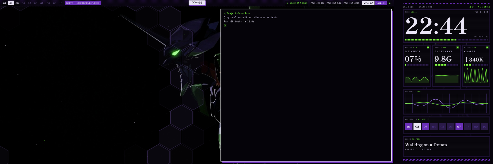
</p>

<h1 align="center">eva-desk</h1>

<p align="center">A Neon Genesis Evangelion desktop for Hyprland.</p>

<p align="center">
  <a href="https://github.com/Singularitty/eva-desk/blob/main/LICENSE"></a>
  
  
</p>

<p align="center">
  <a href="#quick-start">Quick start</a> ·
  <a href="#features">Features</a> ·
  <a href="#install">Install</a> ·
  <a href="#configuration">Configuration</a> ·
  <a href="#faq">FAQ</a> ·
  <a href="#contributing">Contributing</a>
</p>

---

eva-desk is a daemon that runs next to Hyprland and draws the desk in the style of the show's title cards and
NERV screens: heavy mincho type, monospace readouts, purple and acid green on black, hazard stripes when
something is wrong.

It gives you a bar, a launcher, a window switcher, a power menu, a screenshot tool and a sound panel. The
wallpaper moves, slowly. A second monitor shows a wall of readouts while it is empty. When you are away, a
standby screen covers everything. When something happens (an app starts, the session unlocks, a new track
plays), a short sequence plays and the picture holds still again.

It needs Hyprland's Lua config (`hyprland.lua`), not the classic `hyprland.conf`.

<p align="center"></p>

## Quick start

```sh
git clone https://github.com/Singularitty/eva-desk && cd eva-desk
./install.sh --extras all --lock --gtk
```

Hyprland reloads and the daemon starts.

| key | |
|---|---|
| `Super+Space` | launcher |
| `Alt+Tab` | window switcher |
| `Super+M` | power menu |
| `Print` | screenshot |
| `Super+Return` | maximise the window |

The settings are in `~/.config/eva-desk/eva.toml`; run `eva-ctl apply` after editing. `./uninstall.sh` puts
everything back.

## Features

### Launch

<p align="center">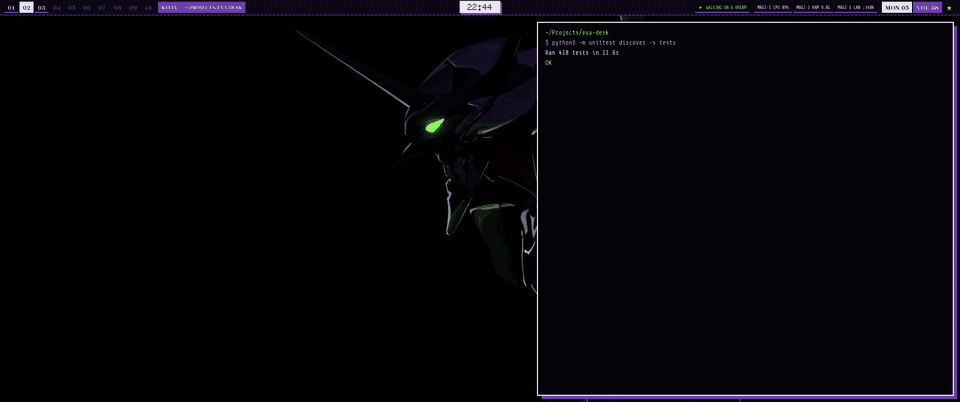</p>

Enter in the launcher plays a two-second sequence while the app opens: a title card with its name, or for a
game a run up a launch shaft. It does not take the keyboard, so what you type goes to the new window as soon
as it is there. A click skips it; Shift+Enter launches without it.

### Sequences

<p align="center">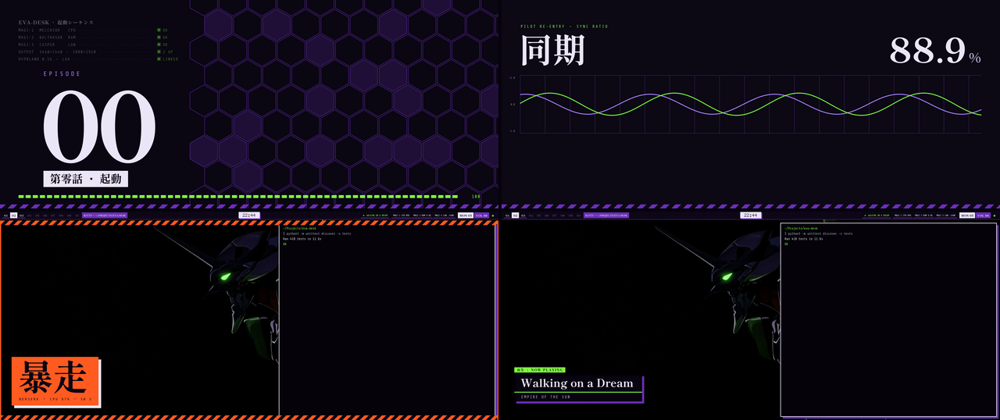</p>

Four more play by themselves: a boot check when the desk first comes up, a sync graph when the session
unlocks or the machine wakes, hazard strips on the screen's edges when the CPU or memory stays pegged, and a
card in a corner when a new track starts playing. The last two never cover anything and keep away from games
and fullscreen windows.

### Standby

<p align="center">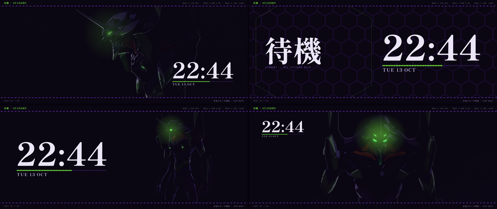</p>

After five idle minutes every monitor shows a slow loop: Unit-01 in the dark, a field of hexagons, the clock,
a cut every fifteen seconds. Any key, a click or moving the mouse folds it away, and that key or click is not
passed on. It does not start over a fullscreen window, while a game is open, or while a video holds the
screen awake; it ends when the session locks or a critical notification arrives. The minutes are counted by
`hypridle`, which the daemon runs. `eva-ctl standby on` shows it now.

### Moving wallpaper

<p align="center">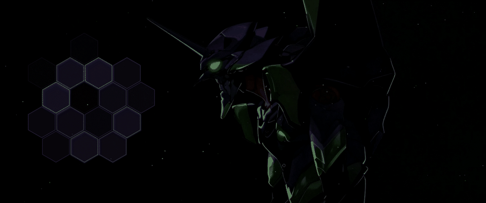</p>

On the main monitors the daemon draws the wallpaper itself: it pushes in and back over thirty seconds with a
slow pan, a ring of hexagons spreads across it now and then, and small specks rise. A new wallpaper fades in
over the old one. The wallpapers are your own; the one above is a stand-in.

### Status wall

<p align="center">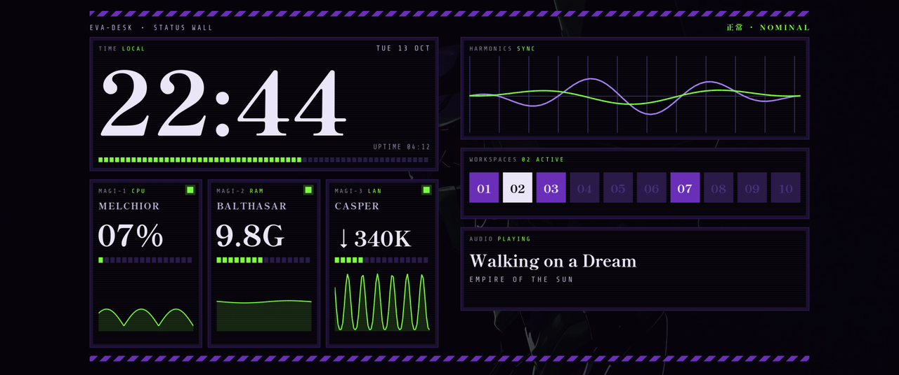</p>

A monitor that is not a main one shows the time, CPU, memory and network with a minute of history, the
workspaces and the playing track, while its workspace holds no window. Upright monitors get one column, as
in the picture at the top; wide ones get two or three.

The wallpaper and the wall stop moving while a game is open, on a monitor with a fullscreen window, on a
locked session and under standby, and `eva-ctl ambient off` stops them by hand.

### Launcher

<p align="center">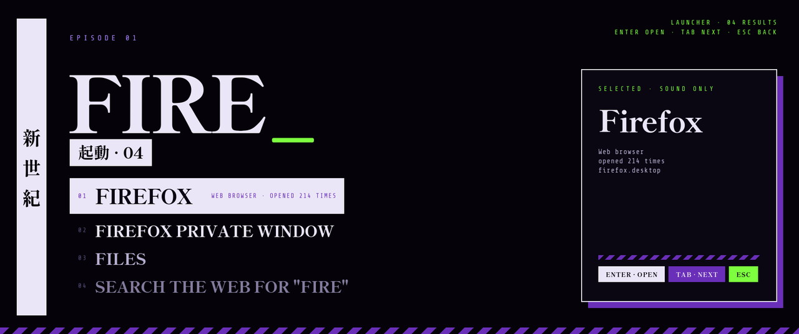</p>

`Super+Space`. Type to search apps; the query is set large, matches are listed under it, and the selected
one gets a card with what it is and how often you opened it. Anything that is not an app is a web search.

### Bar

<p align="center">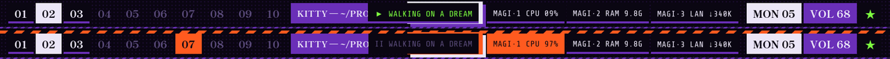</p>

Workspaces, the window title, the playing track, CPU, memory and network, the date, volume and the tray.
An urgent workspace and a pegged CPU turn orange. A critical notification drops a warning band under the bar.

### Alt+Tab

<p align="center">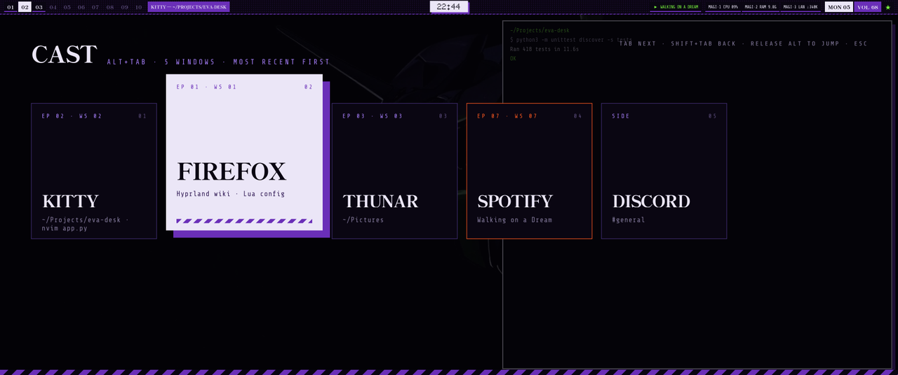</p>

One card per window, most recent first, with its workspace. Release Alt to go there.

### Power menu

<p align="center">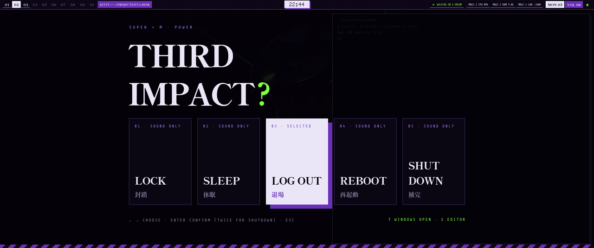</p>

`Super+M`. Lock, sleep, log out, reboot, shut down. Logging out and shutting down ask twice.

### Workspace card

<p align="center">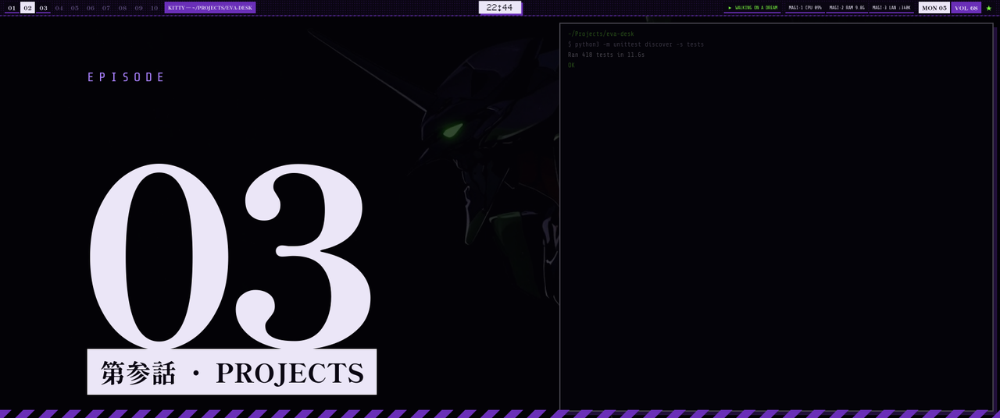</p>

A card with the workspace number, and its name if you give it one, shows for a moment when you switch.

### Screenshots

<p align="center">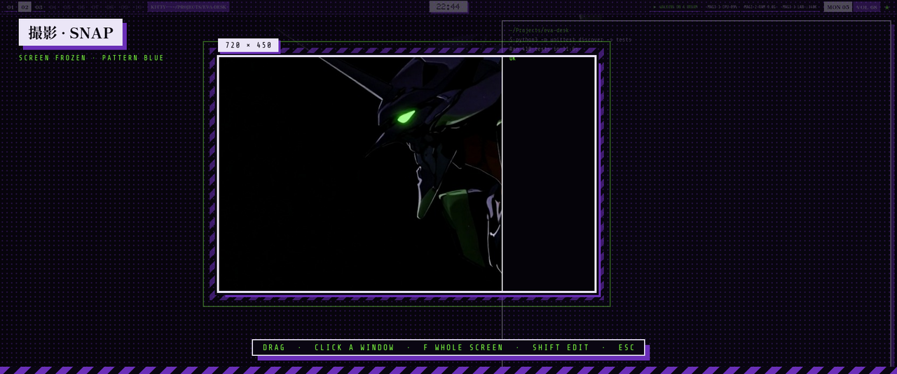</p>

`Print`. The screen freezes; drag a region, click a window, or press `F` for the whole screen. The shot goes
to the clipboard and to `~/Pictures/Screenshots`. Hold Shift as you finish to open it in an editor.

### Sound

<p align="center">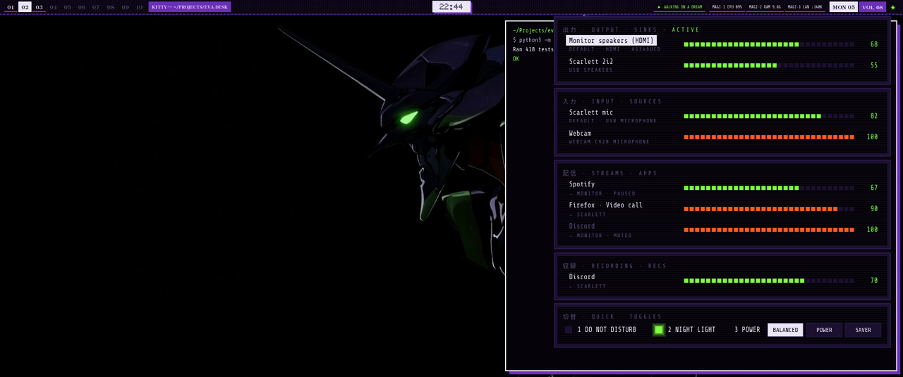</p>

Click `VOL` on the bar. Outputs, inputs, app streams and recordings with their levels: arrows move and set,
`m` mutes, `d` makes a device the default, Enter moves a stream to another device, and `1 2 3` toggle
do-not-disturb, night light and the power profile. Night light runs `wlsunset`; give it a location with
`EVA_NIGHT_ARGS` in the daemon's environment, e.g. `env = EVA_NIGHT_ARGS,-l 39.9 -L 116.3` in your Hyprland config.

### Lock screen

<p align="center">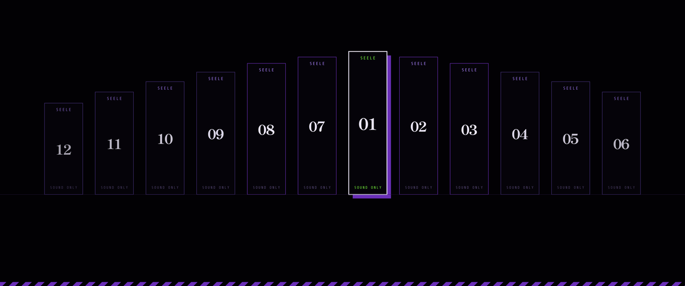</p>

A hyprlock setup with a background for each monitor (`./install.sh --lock`). When the session unlocks, the
wake sequence plays. There is also a matching login screen for greetd with ReGreet:
`sudo greeter/install-greeter.sh` installs it, keeping backups.

### And the rest

- **Windows**: square corners, a purple border and hard shadow, corner brackets, the app and workspace as a
  tag, and a LOCK readout on the focused window. A new window gets one hexagon pulse.
- **Unit-01 behind your windows**: a figure in a column to the right of the windows, and a large one behind a
  maximised window. It is on by default. `eva-ctl figure off` hides the figure and gives its column back;
  `Super+D` docks a window into that column while it is there.
- **Other apps**: `eva-extras` themes kitty, starship, Neovim and the shell to match.

Your own keybinds are left alone. eva-desk adds `Super+Return` and `Super+D`, and takes over your launcher
key, `Print`, `Alt+Tab` and `Super+M`; each can be changed or turned off.

## Install

### Arch

```sh
cd packaging && makepkg -si
eva-desk-setup --extras all --lock --gtk
```

The package installs the program to `/usr/share/eva-desk` and the fonts to `/usr/share/fonts/eva-desk`.
`eva-desk-setup` does the per-user part: it writes `~/.config/eva-desk/eva.toml` and adds one line to your
`hyprland.lua`.

### Any distribution

```sh
git clone https://github.com/Singularitty/eva-desk
cd eva-desk
./install.sh --extras all --lock --gtk
```

This copies the program to `~/.local/share/eva-desk`, puts `eva-desk`, `eva-ctl` and `eva-extras` in
`~/.local/bin`, downloads the fonts, writes `~/.config/eva-desk/eva.toml`, and adds this line to the end of
`~/.config/hypr/hyprland.lua` (keeping a backup):

```lua
dofile(os.getenv("HOME") .. "/.local/share/eva-desk/hypr/eva.lua")
```

If you already run a bar, a wallpaper tool or an idle tool, stop them, or turn eva-desk's off:
`[bar] enabled = false`, `[wallpapers] enabled = false`, `[standby] idle = "none"`.

| flag | |
|---|---|
| `--extras all` | also theme kitty, starship, Neovim and the shell; or a list: `--extras kitty,starship` |
| `--lock` | set up hyprlock: a background per monitor and a `hyprlock.conf` |
| `--gtk` | build the GTK 3 / 4 and icon themes (recoloured from an installed Everforest theme) |
| `--link` | run from the git checkout instead of a copy |
| `--no-hypr` | leave `hyprland.lua` alone |
| `--no-fonts` | skip the font download |

### Dependencies

Hyprland 0.56 or newer with the Lua config, Python 3.11+, PyGObject, pycairo, GTK 4 and gtk4-layer-shell.

Optional, each for one thing: `hypridle` (standby), `playerctl` (the playing track), `awww` or `swww`
(wallpapers on the other monitors), `wpctl` (volume), `grim` and `wl-copy` (screenshots), `hyprlock` (the lock
screen), `pactl` and `gojq` (the sound panel), Pillow (the lock and login backgrounds), `ffmpeg` (video
previews of the motion). The fonts are downloaded by the installer.

```sh
# Arch
sudo pacman -S --needed python-gobject python-cairo gtk4 gtk4-layer-shell hypridle playerctl awww grim wl-clipboard hyprlock
# Debian / Ubuntu
sudo apt install python3-gi python3-gi-cairo gir1.2-gtk-4.0 gir1.2-gtk4layershell-1.0
# Fedora
sudo dnf install python3-gobject python3-cairo gtk4 gtk4-layer-shell
```

### Monitors

Everything is sized from the monitor it is drawn on: 16:9, 16:10, ultrawide, HiDPI and portrait all work.
`[general] main_monitors` names the monitors that get the bar and the moving wallpaper (by output name or part
of the description); empty means the largest one. The others keep a still wallpaper (`[wallpapers] static`),
and the first of them gets the status wall (`[ambient] wall_monitor` picks another).

## Configuration

Everything is in `~/.config/eva-desk/eva.toml`; [`config/eva.example.toml`](config/eva.example.toml) lists
every option with its default. Run `eva-ctl apply` after editing.

| section | |
|---|---|
| `[motion]` | a switch for each sequence: `launch`, `boot`, `wake`, `berserk`, `track` |
| `[standby]` | `enabled`, the idle `minutes`, and `idle = "hypridle"` or `"none"` |
| `[ambient]` | the moving wallpaper (`wallpaper`, `drift`, `lap`, `ripples`, `embers`), the status wall (`wall`, `wall_monitor`), and `fps` |
| `[wallpapers]` | your pool, a wallpaper per workspace, named workspaces, other monitors |
| `[bar]` | height, workspaces, readouts, now playing, tray, click actions, extra buttons |
| `[overlays]` | the workspace card, the warning band, Alt+Tab, the power menu, the pulse, the load limit, the window frame, the sound panel |
| `[figures]` | the figure, the maximise backdrop, and the window classes that are games |
| `[power]` | the commands behind lock, sleep, log out, reboot and shut down |
| `[hyprland]` | keybinds, gaps, borders |

```sh
eva-ctl standby on             # standby, now
eva-ctl ambient off            # stop the moving wallpaper and the wall (on starts them)
eva-ctl play card FIREFOX      # try a sequence: card, shaft, boot, wake, berserk, track
eva-ctl lock                   # lock the screen
eva-ctl figure off             # hide the figure
eva-ctl status | reload | quit
```

Colours and fonts are defined once, by role, in `eva_desk/themes.py`; the GTK theme, the app themes and the
eww palette all read from there. A theme of your own is a copy of the `eva` entry plus its pictures in
`assets/themes/<name>/`, switched to with `eva-ctl theme <name>`.

## FAQ

**It moves too much.** `eva-ctl ambient off` stops the wallpaper and the wall; `wallpaper = false` and
`wall = false` under `[ambient]` turn them off for good. `[motion]` has a switch for each sequence,
`[standby] enabled = false` turns standby off, and `[overlays]` has one for each small effect.

**Does it cost my games anything?** While a window whose class is in `[figures] ignore_classes` is open, the
wallpaper and the wall stand still and standby does not start. Steam games and gamescope are in the list.
The rest of the time the moving wallpaper keeps the GPU compositing; if that shows, lower `[ambient] fps` or
set `drift = 0`.

**Standby came up during a video.** Players that keep the screen awake keep it away; for one that does not,
raise `[standby] minutes`.

**Something looks wrong.** `eva-desk --render /tmp/eva` writes PNGs of exactly what the daemon draws, and
`eva-desk --render-motion /tmp/eva` the motion. If they look right, the problem is on the Hyprland side; if
not, open an issue with the picture. The log is `~/.local/state/eva-desk/eva-desk.log`.

**Can I use it with `hyprland.conf`?** No: the borders, workspace rules and binds come from the Lua config.

**How do I remove it?** `./uninstall.sh`; `--purge` also deletes the settings and the fonts.

## Development

```sh
python3 -m unittest discover -s tests     # the tests, no compositor needed
eva-desk --render DIR                      # every overlay, the bar and the launcher as PNGs
eva-desk --render-motion DIR               # every motion piece as a contact sheet and an mp4
tools/record_readme.py                     # every picture in this README
```

Python, GTK 4 and gtk4-layer-shell. Nothing in this README was captured from a screen: the pictures come from
the same drawing code the daemon uses, with made-up windows and readings.

## Contributing

Issues and pull requests are welcome, especially pictures of your own setup, themes for other Evas (or
anything else), a `hyprland.conf` port, and packages for other distributions. Before sending code, run the
tests and look at the output of `eva-desk --render`.

## Credits

Fonts: Shippori Mincho B1, Share Tech Mono, Rubik and Doto from Google Fonts (OFL). The GTK and icon themes are
recoloured from Everforest. The pictures of Unit-01 were generated locally with stable-diffusion.cpp.

Neon Genesis Evangelion belongs to Hideaki Anno, Gainax and Khara. This is a fan project. MIT licence.
